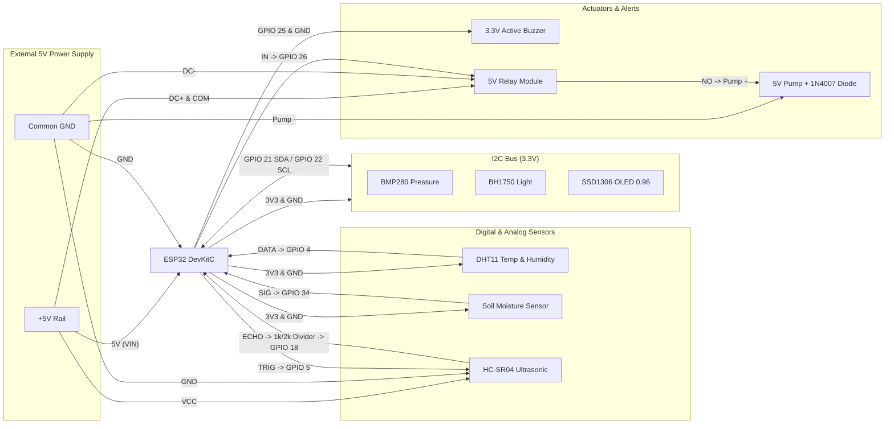

# Green Life — IoT Micro-Climate Monitoring & Precision Agriculture

**Stack:** Next.js (App Router) + Firebase Authentication (Email/Password & Google Sign-In) + Cloud Firestore (`greenlife-db`) + Vercel + Gemini API + ESP32

## 1. Hardware Wiring & Connection Diagram (ESP32)



> **Safety Notes:** Use a `1kΩ + 2kΩ` voltage divider on `HC-SR04 ECHO` (`5V -> 3.3V`), place a reverse-biased `1N4007` flyback diode across the pump terminals, and power the relay/pump from an external `5V` supply with common `GND`.

| Component | ESP32 Pin / Bus | Power & Notes |
|---|---|---|
| BMP280, BH1750, SSD1306 OLED | `GPIO 21 (SDA)`, `GPIO 22 (SCL)` | Shared I²C (`3.3V`, `GND`) |
| DHT11 | `GPIO 4` | `3.3V`, `GND` (`10kΩ` pull-up on `DATA` if bare sensor) |
| Soil Moisture Sensor | `GPIO 34` | Analog ADC1 input (`3.3V`, `GND`) |
| HC-SR04 Ultrasonic | `Trig: GPIO 5`, `Echo: GPIO 18` | `5V`, `GND`; use `1kΩ + 2kΩ` voltage divider on `Echo` |
| 1-Channel 5V Relay + Pump | `GPIO 26` | External `5V` + common `GND`; add `1N4007` flyback diode |
| 3.3V Active Buzzer | `GPIO 25` | `GPIO 25 (+)` and `GND (-)` |

## 2. Firebase Project (`green-life-1436d`)
- Web App registered: `greenlife-web` (`1:214170718127:web:3071937fe7026ea7e3695a`)
- Cloud Firestore database: `greenlife-db` (Enterprise Native, `asia-southeast1`)
- Rules & Indexes: [firestore.rules](./firestore.rules) & [firestore.indexes.json](./firestore.indexes.json)
- Auth providers: Email/Password & Google Sign-In (create one Email/Password user for ESP32, and sign in via Email/Password or Google on the web app).

## 3. Web Dashboard (Local & Vercel)
```bash
cd web
cp .env.example .env.local   # Add Firebase keys + GEMINI_API_KEY
npm install
npm test
npm run dev
```
Deploy `web/` to **Vercel**, add the same environment variables from `web/.env.example`, and add your Vercel domain under Firebase Console → Authentication → Settings → Authorized domains (needed for Google Sign-In).
