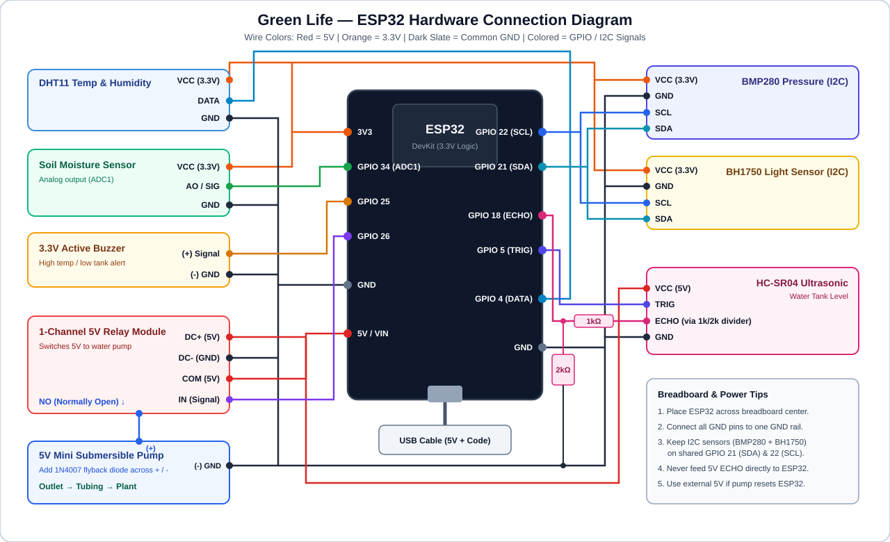
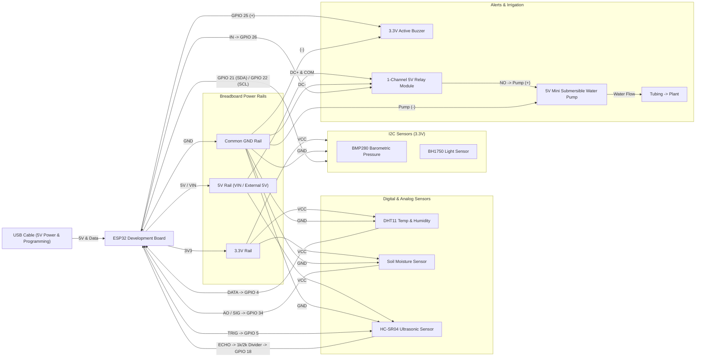

# Green Life — IoT Micro-Climate Monitoring & Precision Agriculture

**Stack:** Next.js (App Router) + Firebase Authentication (Email/Password & Google Sign-In) + Cloud Firestore (`greenlife-db`) + Vercel + Gemini API + ESP32

## 1. Hardware Components & Connection Diagram (ESP32)



### Quick Breadboard Wiring Checklist
1. **Power Rails (`Breadboard` + `USB Cable`):** Plug the `ESP32` into the breadboard and connect `ESP32 3V3` → `+3.3V` rail, `ESP32 5V/VIN` → `+5V` rail, and `ESP32 GND` → `Common GND` rail.
2. **I²C Sensors (`BMP280` + `BH1750`):** Connect both sensors' `VCC` → `3.3V`, `GND` → `GND`, `SDA` → `GPIO 21`, and `SCL` → `GPIO 22`.
3. **Environmental & Soil Sensors:**
   - `DHT11`: `VCC` → `3.3V`, `GND` → `GND`, `DATA` → `GPIO 4`
   - `Soil Moisture Sensor`: `VCC` → `3.3V`, `GND` → `GND`, `AO/SIG` → `GPIO 34`
4. **Water Level (`HC-SR04 Ultrasonic`):** `VCC` → `5V`, `GND` → `GND`, `TRIG` → `GPIO 5`, and `ECHO` → `1kΩ` resistor → `GPIO 18` (with a `2kΩ` resistor from `GPIO 18` to `GND` to drop `5V` safely to `3.3V`).
5. **Buzzer & Auto Irrigation (`Relay + Pump + Tubing`):**
   - `3.3V Active Buzzer`: `(+)` → `GPIO 25`, `(-)` → `GND`
   - `1-Channel 5V Relay`: `DC+` → `5V`, `DC-` → `GND`, `IN` → `GPIO 26`, `COM` → `5V`, `NO` → `Pump (+)`
   - `5V Mini Submersible Pump`: `(-)` → `GND`, outlet → `Tubing` → Plant *(if ESP32 restarts when the pump runs, power the `5V` relay/pump rail from an external `5V` adapter with shared `GND` and add a `1N4007` flyback diode across the pump terminals)*.

<details>
<summary>Mermaid Flow View & Full Pin Table (Click to expand)</summary>



| Component | Qty | ESP32 Pin / Bus | Power & Wiring | Purpose |
|---|---|---|---|---|
| **ESP32 Development Board** | 1 | Main Controller | Powered/programmed via `USB Cable` | Processes sensor data & controls system |
| **DHT11 Temp & Humidity Sensor** | 1 | `GPIO 4` (DATA) | `3.3V`, `GND` | Measures temperature & relative humidity |
| **BMP280 Barometric Pressure Sensor** | 1 | `GPIO 21` (SDA), `GPIO 22` (SCL) | `3.3V`, `GND` (I²C) | Measures atmospheric pressure |
| **BH1750 Light Sensor** | 1 | `GPIO 21` (SDA), `GPIO 22` (SCL) | `3.3V`, `GND` (I²C) | Measures ambient light intensity |
| **Soil Moisture Sensor** | 1 | `GPIO 34` (AO / SIG) | `3.3V`, `GND` (ADC1) | Measures soil moisture condition |
| **HC-SR04 Ultrasonic Sensor** | 1 | `GPIO 5` (TRIG), `GPIO 18` (ECHO) | `5V`, `GND` (`1kΩ+2kΩ` divider on `ECHO`) | Measures distance for water level monitoring |
| **3.3V Active Buzzer** | 1 | `GPIO 25` (+) | `GND` (-) | Provides alerts/warnings |
| **1-Channel 5V Relay Module** | 1 | `GPIO 26` (IN) | `DC+` → `5V`, `DC-` → `GND`, `COM` → `5V`, `NO` → `Pump (+)` | Allows ESP32 to switch the water pump |
| **5V Mini Submersible Water Pump** | 1 | Switched via Relay `NO` | `(+)` ← Relay `NO`, `(-)` → `GND` | Supplies water for automatic irrigation |
| **Breadboard & Jumper Wires** | 1 / - | Prototyping & buses | `3.3V`, `5V`, and `GND` rails | Electrical connections |
| **USB Cable** | 1 | Micro-USB / USB-C | Connected to PC / 5V USB | Programming and powering ESP32 |
| **Tubing** | 1~3 | Pump outlet → Plant | Mechanical water line | Carries water from pump to plant |

</details>

## 2. Firebase Project (`green-life-1436d`)
- Web App registered: `greenlife-web` (`1:214170718127:web:3071937fe7026ea7e3695a`)
- Cloud Firestore database: `greenlife-db` (Enterprise Native, `asia-southeast1`)
- Rules & Indexes: [firestore.rules](./firestore.rules) & [firestore.indexes.json](./firestore.indexes.json)
- Auth providers: Email/Password & Google Sign-In (create one Email/Password user for ESP32, and sign in via Email/Password or Google on the web app).

## 3. Web Dashboard (Local & Vercel)
```bash
cd web
cp .env.example .env.local   # Add Firebase keys + GEMINI_API_KEY
npm install
npm test
npm run dev
```
Deploy `web/` to **Vercel**, add the same environment variables from `web/.env.example`, and add your Vercel domain under Firebase Console → Authentication → Settings → Authorized domains (needed for Google Sign-In).
